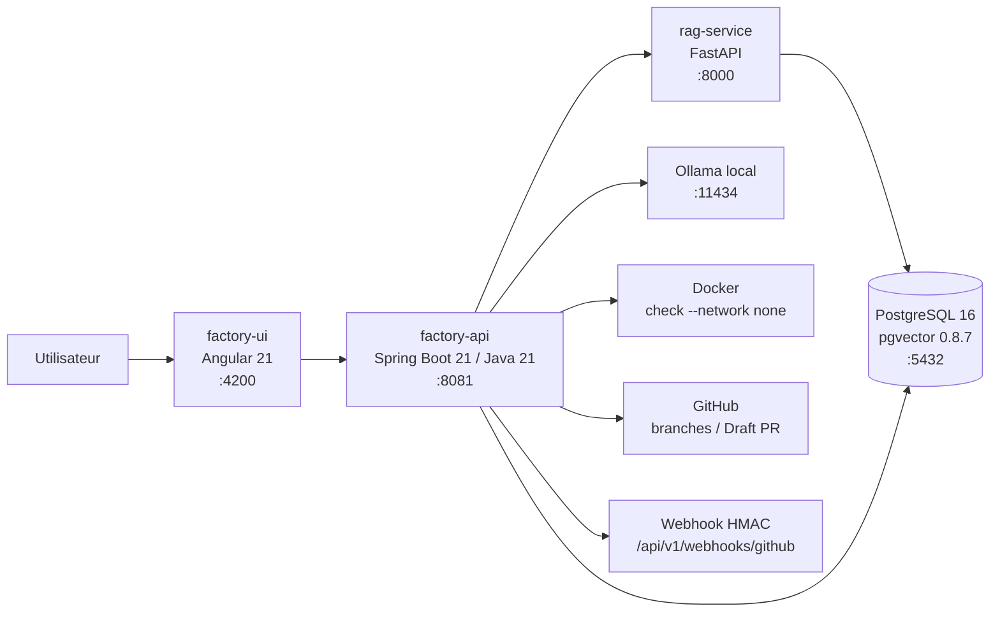
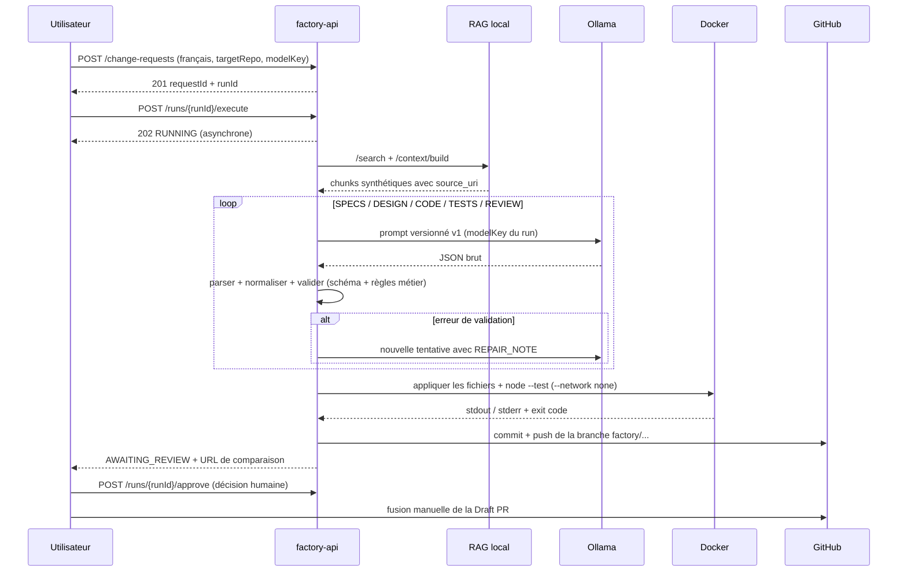

# Part 3 — Document de conception

**Projet :** AI Software Factory — usine logicielle personnelle, locale et hors ligne.
**Version :** 1.0 — 2026-11-19.
**Statut :** capitalise les Parts 1 et 2 et l'état réel des Lots 0 à 6. Les points non encore exécutés sont marqués `VERIFY`.

---

## 1. Objectif et périmètre

Transformer une demande métier **rédigée en français** en une suite vérifiable : exigences → architecture → code → tests → revue → branche GitHub en attente de décision humaine.

Contraintes verrouillées :

| Contrainte | Décision retenue |
|---|---|
| Modèles | Uniquement Ollama local (`qwen2.5-coder:7b`, repli `3b`, embeddings `bge-m3`). Aucune API de modèle externe. |
| Données | Corpus synthétique français, CV fictifs, aucun secret ni donnée réelle. |
| Réseau | Aucune télémétrie. Code généré sans appel sortant. Checks Docker avec `--network none`. |
| Coût | 0 € :open-source uniquement, matériel déjà possédé. |
| SCM | GitHub uniquement. Draft PR, fusion manuelle par l'humain. |
| Langue | Prose, UI, commentaires et rapports en français ; identifiants de code en anglais. |
| Décision | `AWAITING_REVIEW` n'est jamais une validation métier. L'humain approuve et fusionne. |

**ASSUMPTION :** le périmètre pédagogique prime sur la performance brute. Un pipeline déterministe et auditable est préférable à un modèle plus gros mais opaque.

---

## 2. Architecture



Responsabilités :

- **factory-ui** : saisie de la demande, suivi de l'exécution, URL de comparaison, décision humaine.
- **factory-api** : ordonnanceur, validations, persistance, journal d'audit, intégration GitHub.
- **rag-service** : ingestion, découpage, embedding local, recherche hybride, construction de contexte.
- **PostgreSQL** : source de vérité (demandes, runs, artefacts, événements, audit, corpus RAG).
- **Ollama** : unique fournisseur d'inférence et d'embedding.
- **Docker** : bac à sable des tests générés, sans réseau.
- **GitHub** : dépôt cible, branches `factory/...`, Draft PR manuelles.

**VERIFY :** les versions exactes sont celles relevées le 2026-11-19 (Spring Boot 3.5.16, Spring AI 1.0.9, JJWT 0.12.6, Angular 21.2.26, TypeScript 5.9, Python 3.14, PostgreSQL 16.16, pgvector 0.8.7). À confirmer après toute mise à jour.

---

## 3. Flux d'une demande



Points clés :

1. L'exécution est **asynchrone** : `POST /execute` rend la main immédiatement, `GET /execution` et `GET /events` servent au suivi.
2. Chaque tentative d'agent est persistée dans `agent_output` avec le prompt haché, le modèle, les erreurs de validation et la latence.
3. Le journal `audit_log` est chaîné par hachage SHA-256 (`prev_hash` → `hash`).
4. Aucune étape ne fusionne, ne déploie et ne crée de PR sans intervention humaine (sauf `PFE_GITHUB_TOKEN` optionnel, non défini ici).

---

## 4. Modèle de données

Tables principales (schéma `factory-api/src/main/resources/schema.sql`) :

| Table | Rôle |
|---|---|
| `app_user` | 3 utilisateurs fictifs locaux (requester, reviewer, admin). |
| `model_config` | clés `ollama-local`, `ollama-local-3b`, `ollama-embed-local`. |
| `change_request` | texte métier, cible, dépôt, langue, statut. |
| `requirement_item` | exigences extraites, avec critères et `source_uri`. |
| `generation_run` | run, modèle utilisé, version de prompts, branche, URL PR. |
| `pipeline_event` | événements de stage (y compris `GITHUB_PR` / `AWAITING_HUMAN`). |
| `agent_output` | sorties brutes normalisées, tentatives, erreurs, latences. |
| `artifact` | fichiers générés avec empreinte SHA-256. |
| `check_result` | commandes Docker, codes de sortie, sorties tronquées. |
| `traceability_link` | lien exigence → artefact → chemin de fichier. |
| `approval` | décision humaine (`APPROVED`, `CHANGES_REQUESTED`, `REJECTED`). |
| `audit_log` | journal chaîné, y compris les webhooks GitHub. |
| `rag_document` / `rag_chunk` | corpus synthétique, `vector(1024)`, `tsvector('french')`. |

**VERIFY :** la dimension `vector(1024)` est figée par BGE-M3. La modifier après la première ingestion imposerait un ré-embedding complet. Le type `stage_name` conserve l'ancien libellé `GITLAB_MR` pour les lignes historiques et contient désormais `GITHUB_PR`.

---

## 5. Les cinq agents

| Agent | Sortie | Validation déterministe principale |
|---|---|---|
| SPECS | exigences + citations | `source_uri` doivent appartenir au contexte RAG ; aucune question bloquante (données réelles, production). |
| DESIGN | `filePlan` | chaque exigence couverte ; `CREATE` sur un chemin inexistant, `MODIFY` sur un chemin connu. |
| CODE | fichiers | chemin autorisé, < 200 lignes, pas d'appel externe/API dangereuse, imports ESM présents, clés i18n parallèles. |
| TESTS | fichiers de test | `node:test` sous `test/`, pas de `require()`, pas de `Date.now`/`Math.random`, imports présents. |
| REVIEW | décision + findings + traçabilité | `externalCalls` vide, pas de `BLOCKER` avec `APPROVE`, toutes les exigences couvertes, checklist de biais pour `demo-hr-app`. |

Prompts et schémas sont versionnés dans `factory-api/src/main/resources/prompts/v1/` et `schemas/`. Les identifiants restent anglais ; les consignes sont françaises.

**ASSUMPTION :** un modèle 7B local ne respecte pas toujours strictement un schéma JSON. L'orchestrateur applique donc des **normalisations déterministes** : suppression du bruit JSON Schema, enveloppement des sorties nues, complétion de la couverture des exigences, ajout des imports ESM manquants, parité des dictionnaires et complétion de la traçabilité REVIEW. Ce ne sont pas des inventions du modèle : ce sont des garde-fous du système.

---

## 6. RAG local

- Corpus : 6 documents synthétiques français, 20 chunks (standards, exemples, ADR, modèles de test).
- Découpage puis embedding via `bge-m3` sur `http://localhost:11434`.
- Recherche **hybride** : similarité cosine pgvector + `tsvector('french')`.
- Le contexte injecté dans SPECS est la seule source autorisée pour les `source_uri`.
- Le service expose `/search`, `/context/build`, `/ingest`, `/health`.

**ASSUMPTION :** un corpus réduit mais maîtrisé suffit pour la démonstration ; la qualité du grounding prime sur le volume.

---

## 7. Boucle generate / check / retry

```text
pour chaque étape :
    rendre le prompt (v1)
    appeler Ollama (modèle du run, options anti-répétition)
    parser le JSON (avec récupération des enveloppes nues)
    normaliser de façon déterministe
    valider : MiniJsonSchema + DomainValidator
    si erreur -> REPAIR_NOTE, nouvelle tentative (SPECS/DESIGN : 2, CODE/TESTS/REVIEW : 3)
    sinon -> persister agent_output et passer à l'étape suivante

après CODE :
    contrôle de parité i18n
    Docker --network none : node --test test/*.test.js
    si échec -> réparation multi-fichiers, maximum 4 par run
    si signature d'erreur répétée -> circuit breaker, AWAITING_HUMAN
```

Options anti-boucle du modèle : `temperature=0.1`, `repeat-penalty=1.15`, `repeat-last-n=64`. Ces valeurs sont appliquées dans `application.yml` et dans la surcharge `OllamaOptions` du harnais d'évaluation.

---

## 8. Intégration GitHub

- `ScmClient` crée une branche `factory/{requestId}/{runId}`, committe les fichiers générés et pousse vers le dépôt cible (`targetRepo` par demande).
- Sans `PFE_GITHUB_TOKEN`, l'API renvoie une **URL de comparaison** : l'humain crée la Draft PR manuellement.
- Avec un token, la Draft PR est créée via l'API GitHub. Ce token n'est jamais stocké.
- Le workflow CI cible est un **template déterministe** injecté sous `.github/workflows/factory-generated-ci.yml` ; il ne remplace pas un workflow existant.
- `POST /api/v1/webhooks/github` vérifie `X-Hub-Signature-256` (HMAC-SHA256) et trace l'événement dans `audit_log`. Signature invalide → 401.
- Protection de branche, webhook public et nettoyage des branches : procédures manuelles dans `docs/GITHUB_SETUP.md`.

**ASSUMPTION :** GitHub ne peut pas joindre `127.0.0.1`. Le webhook est testable en local ; le recevoir depuis GitHub nécessite une URL publique, ce qui sort du cadre 100 % local. Il reste donc optionnel.

---

## 9. Interface et sécurité

- Angular 21 autonome, une page en quatre sections : connexion, demande, suivi, décision.
- Connexion locale via `POST /api/v1/auth/dev-token` (JWT signé avec une clé de développement).
- CORS limité à `http://localhost:4200` et `http://127.0.0.1:4200` sur `/api/**`.
- Aucun secret réel, aucun appel à un service externe, aucune télémétrie (`factory.telemetry.enabled=false`).
- La génération ne doit jamais produire de réseau sortant, de clé API, de `innerHTML`, de `child_process`, de `subprocess` ou de `require()` en ESM : contrôle statique + exécution isolée.

---

## 10. Évaluation

- 12 tâches synthétiques, 2 modèles (`ollama-local` 7B par défaut, `ollama-local-3b` déclaré inactif).
- Harnais Python standard : `list`, `dry-run`, `run`, `report`.
- Chaque run pousse une branche : la commande `run` exige un flag explicite.
- Baseline manuelle : temps réel et note de qualité saisis par l'humain.
- Succès technique = `AWAITING_REVIEW` ; la qualité métier reste évaluée par l'humain.

**VERIFY :** aucun run d'évaluation réel n'a encore été lancé ; le modèle 3B n'est pas installé sur la machine (`ollama list`). Voir `docs/eval/README.md`.

---

## 11. Décisions écartées

| Option écartée | Raison |
|---|---|
| API de modèle externe (Groq, Gemini, OpenAI) | Coût, confidentialité, dépendance réseau : contraire au cahier des charges. |
| GitLab | Le cahier des charges impose GitHub. |
| Fusion automatique / auto-merge | Le cahier des charges impose une validation humaine avant fusion. |
| Commit direct sur la branche par défaut | Empêche la revue et la traçabilité. |
| Prompt unique « tout-en-un » | Sorties instables avec un 7B local ; découpage en 5 agents + validations deterministiques. |
| `vector(768)` | BGE-M3 produit 1024 dimensions : dimension vérifiée, pas devinée. |

---

## 12. État des preuves et limites

Preuves réelles au 2026-11-19 :

- **TC-01 vert** : run `4e428258-dbf0-45a3-b04b-b5dc09e3f3f4`, `SPECS → DESIGN → CODE → TESTS → REVIEW → AWAITING_REVIEW`, branche poussée et vérifiée par `git ls-remote`, aucune fusion.
- Webhook HMAC : signature valide → `recorded: true`, signature fausse → 401.
- Build Angular vert, page servie sur 4200 sans erreur console, connexion locale testée.
- Rapport d'évaluation généré avec une ligne synthétique (supprimée ensuite).

**VERIFY (clos) :** TC-01 a été rejoué le 2026-11-19 (run `098b26f5-58d3-4dce-a88c-6a37871a4aa1`). Le workflow cible déterministe est présent dans la branche poussée. Un bug de workspace résiduel entre deux runs a été trouvé et corrigé par `RepoClient.resetToDefault()` : chaque run repart désormais d'une branche par défaut propre.

Limites connues : compteurs de jetons non remontés par l'API (0 dans `agent_output`), qualité non notée automatiquement, webhook public non configuré, modèle 3B absent, 24 runs d'évaluation non exécutés.

---

## 13. Commandes utiles

```powershell
# Démarrage
powershell -ExecutionPolicy Bypass -File scripts\tc01.ps1

# Évaluation sans effet de bord
python scripts/eval_harness.py list
python scripts/eval_harness.py dry-run

# UI
cd "C:\factory ai\factory-ui"; npm start

# État du pipeline
docker exec pfe-pg psql -U pfe -d pfe_factory -P pager=off -c "select stage,status,message from pipeline_event order by id desc limit 20;"
```

Glossaire : **run** = exécution d'un pipeline ; **stage** = étape d'agent ; **check** = contrôle déterministe ; **repair** = tentative de correction ; **circuit breaker** = arrêt après signature d'erreur répétée ; **grounding** = ancrage des citations dans le RAG local.
